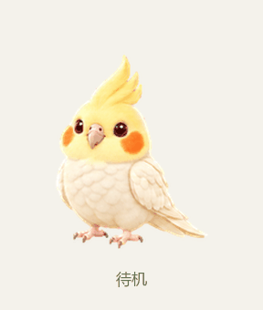
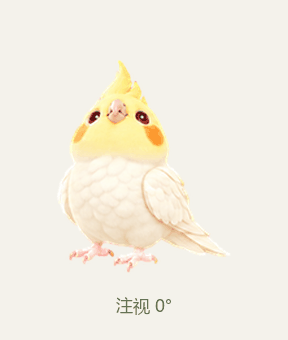
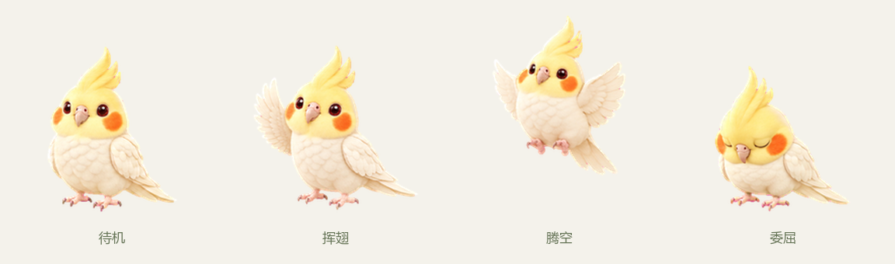

# 黄化玄凤 · Codex 桌宠

一只奶白羽毛、淡黄头冠、橙色脸颊的小玄凤，在 Codex 原生桌宠窗口里陪你工作。



## 下载与安装

从 [最新发布页](https://github.com/john-wang880/codex-lutino-cockatiel/releases/latest) 下载 `codex-lutino-cockatiel-v1.0.0.zip` 并解压。

需要 Windows、PowerShell 7（`pwsh`）和支持本地自定义桌宠的 Codex 桌面版。

在解压目录打开终端，运行：

```powershell
pwsh -NoProfile -File .\Install.ps1
```

安装脚本验证精灵图的 SHA-256 后，复制 `pet.json` 和 `spritesheet.png` 到 `%USERPROFILE%\.codex\pets\xuanfeng-lutino`。若目标目录存在不同的精灵图，脚本会停止并保留原文件。

然后打开 **Codex 设置 → Pets → Refresh**，选中 **黄化玄凤**。若桌宠已收起，点击 **Wake Mini**。

### 手动安装

1. 新建 `%USERPROFILE%\.codex\pets\xuanfeng-lutino` 目录。
2. 将本项目的 `pet.json` 和 `spritesheet.png` 复制到该目录。
3. 在 Codex 设置 → Pets 中点击 Refresh，选中“黄化玄凤”。

## 互动

| 操作或状态 | 表现 |
| --- | --- |
| 鼠标移入桌宠 | 跳跃 |
| 移动鼠标 | 16 个方向的注视 |
| 拖动桌宠 | 改变位置，横向拖动播放左右移动动画 |
| 点击桌宠 | 唤起 Codex 主窗口并聚焦输入框 |
| Codex 任务状态变化 | 切换工作、等待回应、失败、检查成果等动作 |

精灵图提供 9 种标准动画：待机、右移、左移、工作、等待、跳跃、失败、挥翅和检查成果。具体触发由 Codex 原生桌宠行为决定。



## 离线预览

双击打开 `preview.html`，可离线查看动作、注视和拖动效果。预览页的“点击挥翅、双击跳跃”用于演示动画；Codex 原生点击行为见上表。

## 文件与素材

| 文件 | 用途 |
| --- | --- |
| `pet.json`、`spritesheet.png` | Codex 原生桌宠文件 |
| `Install.ps1`、`SHA256.txt` | 安装与精灵图校验 |
| `preview.html` | 离线互动预览 |
| `ARTWORK_PROMPTS.md` | 图像创作提示 |
| `QA.json` | 发布包中的质量检查记录 |
| `assets/` | GIF 与静态预览 |

[发布页](https://github.com/john-wang880/codex-lutino-cockatiel/releases/latest) 同时提供：

- `codex-lutino-cockatiel-v1.0.0.zip`：可安装版。
- `codex-lutino-cockatiel-artwork-v1.0.0.zip`：创作素材包。
- `SHA256SUMS.txt`：发布附件的 SHA-256 校验值。

## 规格与检查

精灵图采用 v2 格式：**1536 × 2288 px，8 列 × 11 行，单格 192 × 208 px**。9 种标准状态共 57 帧，加上 16 个注视方向，共 73 帧；其余 15 格完全透明。

结构和质量检查通过（`ok: true`）。三个代理完成 14 组方向对比盲检，汇总验证通过。质量记录保留了两个辨识较弱斜角、脚尾之间正常透明间隙及相邻方向差异的提示，不代表所有检查均无警告。



图像由 ImageGen 生成，并经过帧提取、位置统一、透明边缘处理和验证；创作提示随仓库及素材包提供。
